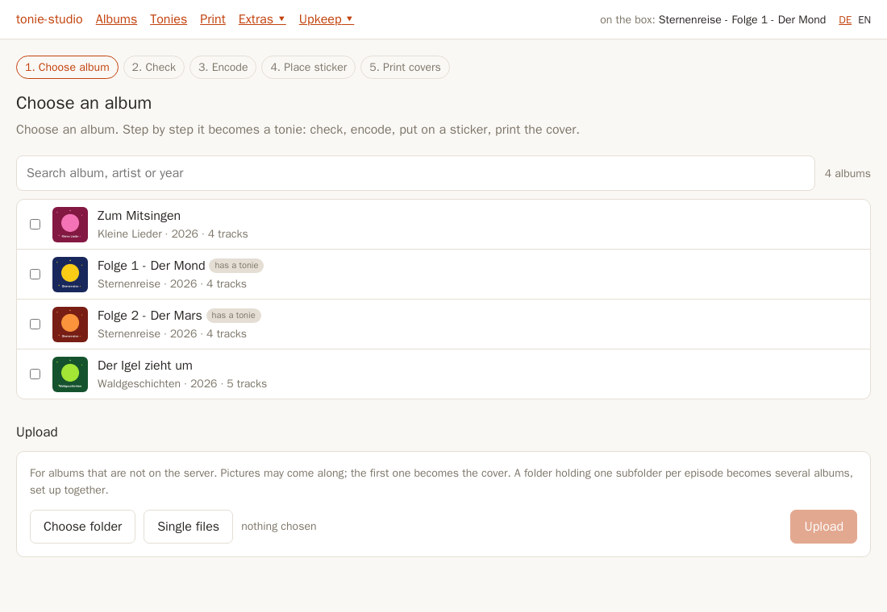
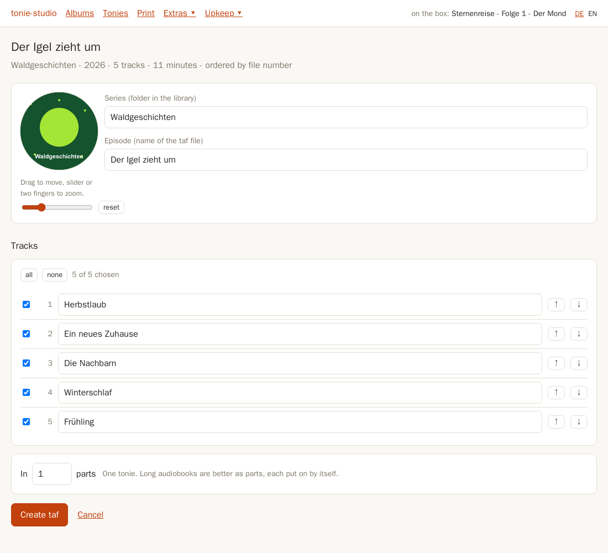
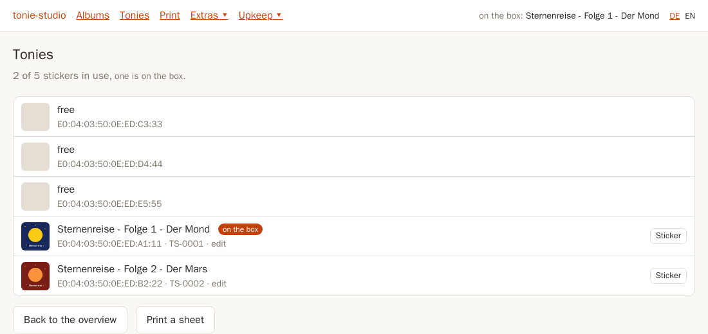
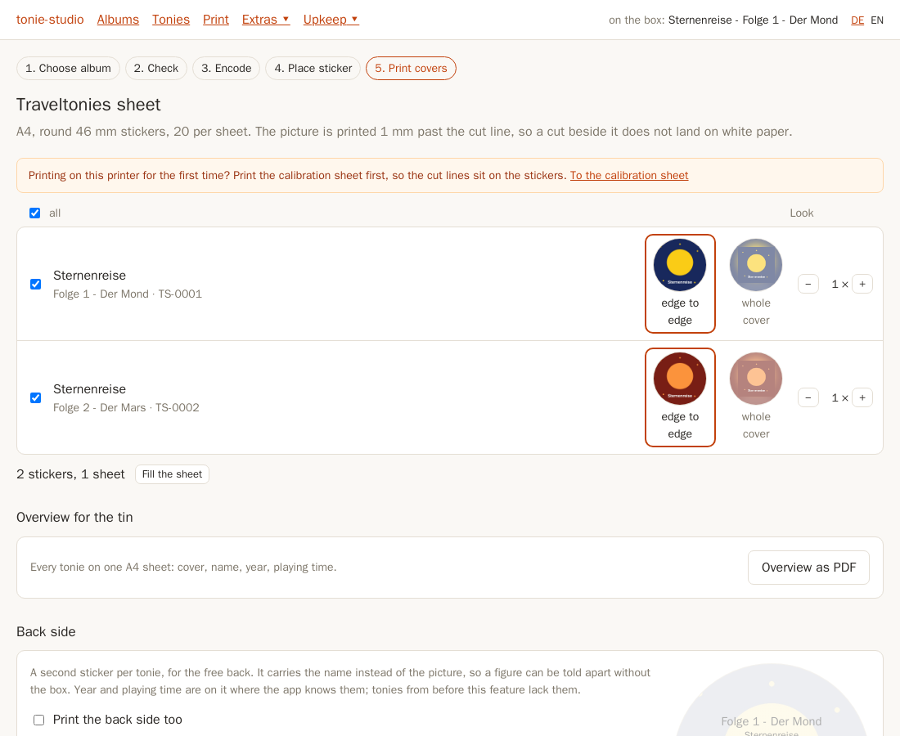
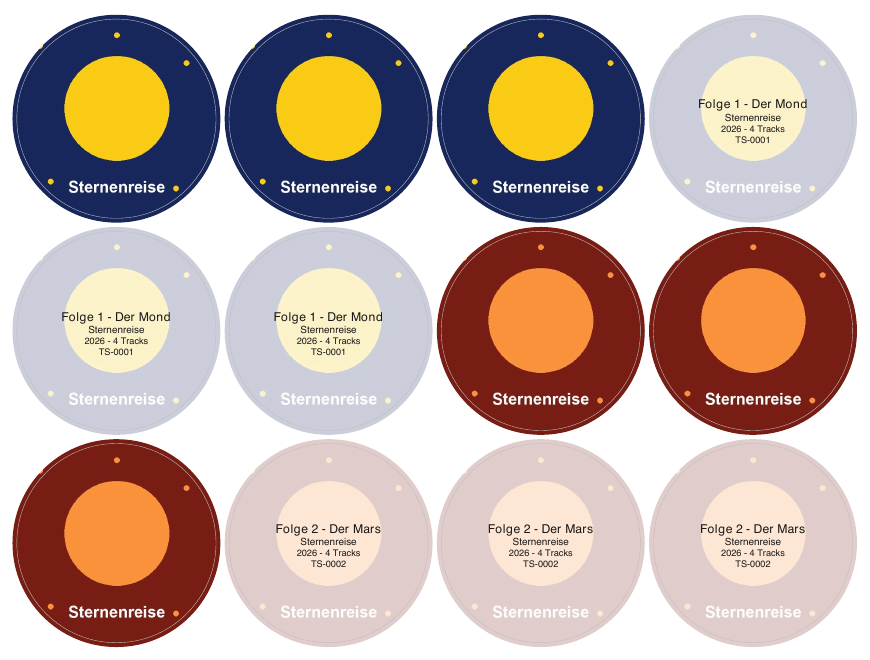

# tonie-studio

**Make your own Toniebox figures from your music and audiobooks, with teddyCloud: encode an album
into a TAF, put it on an NFC tag, give it a cover, and print round covers to cut out.**

tonie-studio is a web app that runs next to
[teddyCloud](https://github.com/toniebox-reverse-engineering/teddycloud). teddyCloud can do most
of these steps, but each on a different screen with its own vocabulary, and the printing not at
all. tonie-studio takes one album the whole way, in the order you actually work: choose the album,
check the tracks, encode, lay the tag on the box, print the covers.



## What it does

- **Albums from your archive or the browser.** Browse a folder of albums (a NAS share, for
  example), or upload a folder or single files. Tracks are put in order by file number, track tag,
  playlist or name, and karaoke takes are recognised and left unticked.
- **Check before encoding.** Rename and reorder tracks, choose which to keep, drag and zoom the
  cover inside the circle, and split long audiobooks into parts. tonie-studio refuses a split the
  box could not play instead of letting teddyCloud merge chapters silently.
- **Encode through teddyCloud,** with progress in minutes rather than a frozen bar.
- **Put it on a tag.** The tag lying on the box is preselected. A tag that already plays something
  is only replaced after you confirm.
- **Several albums at once.** Pick ten episodes of a series and they are encoded one after
  another. Free tags are handed out automatically, or one by one in the order you lay them on the
  box.
- **Custom tonies with covers.** Every tag gets a custom model in teddyCloud with the cover, the
  series, the episode and the track names.
- **Print the covers.** Round 46 mm covers, 20 to a plain A4 page, to cut out, for example for
  the slots of a coin collector tin. The picture fills the circle or sits whole inside it, and it
  is printed a little past the cut line, so a slightly crooked cut shows no white edge. Optionally
  a back side with name, year, playing time and model number, an overview sheet of every tonie to
  keep with the tin, and a calibration sheet that lines your printer up with the cut lines.
- **Radio and podcasts.** Point a tag at a radio stream, or at a podcast whose newest episodes are
  fetched and encoded on their own.
- **Upkeep.** What is on the box right now, a listening log, the TAF library with the tags that
  play each file, a checkup that finds and repairs broken tags, and backup and restore of
  everything teddyCloud does not keep in the archive.
- **German and English.**

| Check an album | Your tonies |
|---|---|
|  |  |

| Choose what to print | The printed sheet |
|---|---|
|  |  |

The screenshots use generated demo albums and covers.

## How the pieces fit together

A tonie made this way is three things that teddyCloud keeps apart:

- a **TAF** in teddyCloud's library: the encoded audio, one chapter per track
- a **tag entry**, which points one physical NFC tag at that TAF
- a **custom model** in `tonies.custom.json`, which supplies the cover and the track names and is
  attached to the tag through its `tonie_model` field

The fourth piece is physical: the round printed cover that goes with the tag. That is the part no
other tool produces, and the reason this one exists.

**A tag has to be known before it can be filled.** teddyCloud learns an NFC tag the first time the
Toniebox reads it. A fresh tag is invisible until it has been held against the box once, so a new
tonie starts at the box, not here.

## Requirements

- teddyCloud **0.7.0 or newer** (custom tonies are written through an API that 0.7.0 introduced),
  with your Toniebox connected to it
- NFC tags your Toniebox reads; see the teddyCloud documentation
- for printing: any printer and plain A4 paper; the covers are cut out by hand

## Quick start with Docker

```bash
docker build -t tonie-studio .
docker run -d --name tonie-studio -p 8080:8080 \
  -e TS_TEDDYCLOUD_URL=http://teddycloud:80 \
  -v /path/to/your/audio:/archive:ro \
  -v tonie-studio-data:/data \
  tonie-studio
```

Then open http://localhost:8080. The container has to reach teddyCloud's web interface; on the
same Docker network or in the same Kubernetes namespace that is the service name.

### Configuration

| Variable | Default | Meaning |
|---|---|---|
| `TS_TEDDYCLOUD_URL` | (required) | teddyCloud's web interface, for example `http://teddycloud:80` |
| `TS_ARCHIVE_DIR` | `/archive` | Folder of albums to choose from; only ever read |
| `TS_DATA_DIR` | `/data` | Writable: spooled uploads, playing times, the listening log, podcast state |
| `TS_TEDDYCLOUD_OVERLAY` | (none) | Selects one box's settings in teddyCloud, only needed with several boxes |
| `TS_LOG_LEVEL` | `INFO` | Python log level |

An album is a folder of audio files (MP3, M4A, FLAC, OGG, Opus, WAV and others), optionally with a
cover image in it.

## Security: put it behind a login

tonie-studio has **no login of its own**, and teddyCloud's API does not either. Anyone who can open
tonie-studio can change every tag and delete TAFs. Run it only on a network you trust, or behind an
authenticating reverse proxy (oauth2-proxy, Authelia, an OIDC gateway, ...). Never expose it, or
teddyCloud, directly to the internet.

Within that, it refuses form posts that a page on another site started, checks a backup's size
and contents before reading it, and only fetches podcasts from public addresses.

## Development

```bash
python3 -m venv .venv
.venv/bin/pip install -r requirements.txt pytest
.venv/bin/python -m pytest -q
uvx ruff check src tests
for test in tests/js/*.test.mjs; do node "$test"; done   # needs Node 22
```

To run it locally, set `TS_TEDDYCLOUD_URL` (and usually `TS_ARCHIVE_DIR` and `TS_DATA_DIR`) and
start `uvicorn --factory tonie_studio.main:app` with `src` on the `PYTHONPATH`.

## Not affiliated with tonies

tonie-studio is an independent project. It is not affiliated with, endorsed by or connected to
Boxine GmbH or tonies. "Toniebox", "Tonie" and "Traveltonie" are trademarks of Boxine GmbH. Use
it with audio you are entitled to use.

## License

tonie-studio is free software under the GNU General Public License, version 3: you may use,
change and share it, and a version you distribute must stay under the same license with its
source. The full text is in [LICENSE](LICENSE).
